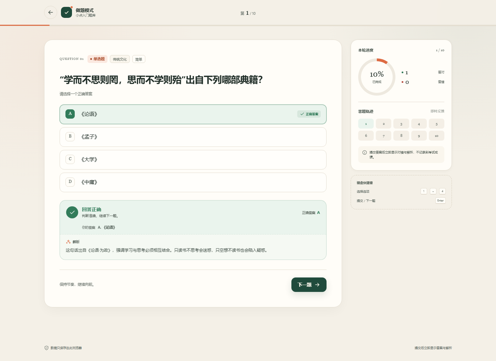
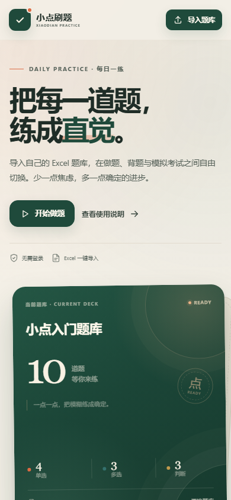

# 小点刷题

一个纯本地运行的做题应用：导入自己的 Excel 题库，在「做题」「背题」「考试」三种模式之间切换。无需登录、无需后端，题库与练习记录保存在浏览器本地。

## 界面预览






## 快速开始

1. 直接双击打开 `index.html`。应用不依赖构建工具、网络或外部 CDN。
2. 首次打开会载入一份 10 道题的「小点入门题库」，可以立即体验三种模式。
3. 点击右上角「导入题库」，选择按约定填写的 `.xlsx` 文件，即可替换题库。
4. 不知道 Excel 怎么填时，点击首页的「题库格式」查看字段说明，或直接使用 `assets/question-bank-template.xlsx`。

> 推荐使用最新版 Edge / Chrome / Firefox。Excel 解析使用浏览器原生解压能力，IE 和过旧的浏览器不受支持。

如果希望通过本地服务器访问，也可以在项目目录运行：

```bash
python -m http.server 8000
```

然后打开 `http://localhost:8000`。

> 直接双击 `index.html` 时所有答题功能都可用，但浏览器不允许 `file://` 页面注册 Service Worker，因此“安装到主屏”和离线缓存只在部署到 HTTPS 后生效。

## 手机安装与离线使用（PWA）

项目已内置 `manifest.webmanifest`、Service Worker 和手机主屏图标。部署到支持 HTTPS 的静态托管后，可以像普通 App 一样安装到手机桌面：

1. 用手机浏览器访问部署后的网址，**先在线完整打开一次**，等待 Service Worker 完成缓存。
2. iPhone 使用 **Safari**：点击分享按钮 → 「添加到主屏幕」。
3. Android 使用 **Chrome / Edge**：打开菜单 → 「安装应用」或「添加到主屏幕」。
4. 从桌面图标再打开一次，确认可以进入后，再在应用内导入 Excel 题库。这样可确保题库保存在安装后的 PWA 存储环境中。
5. 首次访问必须联网；应用脚本被缓存后，断网也能打开做题。

PWA 缓存的是应用本身（HTML、CSS、JS、图标）。导入的 Excel 题库和练习记录仍保存在手机浏览器本地，不会因为缓存被上传到服务器。

> 更新已部署的应用时，请修改 `sw.js` 中的 `CACHE_VERSION`（例如 `v1` → `v2`）再重新部署。新版本安装后重新打开应用即可使用新缓存。

## 部署到免费静态托管

这个应用没有后端，不需要购买服务器。可以选择免费静态托管，也可以使用国内云厂商的对象存储静态网站功能。

### 已经整理好的部署包

- [`deploy/`](deploy/)：可直接拖拽上传的纯静态目录。
- [`小点刷题-部署包.zip`](小点刷题-部署包.zip)：与 `deploy/` 内容一致，根目录就是应用入口。

两种方式任选；平台支持上传 zip 时直接上传压缩包，不支持时解压后拖动整个文件夹。

### 方式一：Netlify Drop / Cloudflare Pages（最省事）

1. 打开 Netlify Drop，或 Cloudflare 控制台的 **Workers & Pages → Pages → 上传资源**。
2. 把 `deploy/` 文件夹拖进去（不要只拖 `index.html`）。
3. 等待构建完成，得到 `https://xxx.netlify.app` 或 `https://xxx.pages.dev` 地址。
4. 手机访问该地址，按上面的步骤添加到主屏幕。

有些免费平台会要求登录或认领站点，按页面提示完成即可。建议长期使用同一网址，避免浏览器本地题库数据因域名变化而“消失”。

### 方式二：GitHub Pages

1. 新建一个 GitHub 仓库。
2. 把 `deploy/` 里的**内容**上传到仓库根目录，保持 `js/`、`assets/` 目录结构。
3. 进入仓库 **Settings → Pages**，选择从 `main` 分支根目录部署。
4. 稍等片刻，访问 `https://用户名.github.io/仓库名/`。

所有资源都使用相对路径，所以部署在子路径下也能正常工作。

### 方式三：国内访问更稳定

如果 GitHub Pages / Netlify 在手机上访问不稳定，可以把 `deploy/` 中的静态文件上传到腾讯云 COS、阿里云 OSS 或腾讯云 CloudBase 的静态网站托管。这种方式不需要运行 Node/Python 服务，只需要开启静态网站访问。自定义域名并使用中国大陆节点时，域名通常需要备案。

### 部署要点

- 必须保持目录结构完整；不要单独上传 `index.html`。
- Service Worker 只在 HTTPS（或 `http://localhost`）下生效。
- 部署后先在线打开一次，确保安装和离线缓存可用。
- 免费静态站点通常知道网址即可访问。当前导入的题库只存在你的浏览器里，不会随网站公开；如果需要限制别人打开应用，可以再接入 Cloudflare Access 或登录鉴权。

## Excel 题库字段结构

- 只读取文件的**第一张工作表**。
- 表头可位于前 15 行内（允许上方有标题行），列顺序不限。
- 一行一道题，空行自动跳过。
- 字段名不区分大小写，会自动去掉空格。

| 字段 | 是否必填 | 约定 |
| --- | --- | --- |
| `题型` | 必填 | `单选` / `多选` / `判断`，也兼容“单选题”“多项选择”等写法 |
| `题干` | 必填 | 题目正文，支持换行 |
| `选项A`、`选项B` | 条件必填 | 单选、多选至少填写 A、B 两项；判断题可留空 |
| `选项C`…`选项Z` | 可选 | 需要更多选项时依次增加列，留空的选项会被忽略 |
| `正确答案` | 必填 | 单选题填一个字母，如 `A`；多选题填多个字母，如 `ABD` 或 `A,B,D`；判断题填 `正确` / `错误` |
| `解析` | 可选 | 做题提交、考试交卷或背题时展示，支持换行 |
| `分值` | 可选 | 正数，缺省为 `1`；考试按分值累计总分 |
| `分类` | 可选 | 分类/章节/知识点，缺省归入「未分类」 |
| `难度` | 可选 | 仅作展示，建议填 `简单` / `中等` / `困难` |

判断题兼容的答案写法：

- 正确：`正确`、`对`、`是`、`真`、`√`、`✓`、`T`、`TRUE`、`A`、`1`
- 错误：`错误`、`错`、`否`、`假`、`×`、`X`、`✗`、`F`、`FALSE`、`B`、`0`

示例：

| 题型 | 题干 | 选项A | 选项B | 选项C | 选项D | 正确答案 | 解析 | 分值 | 分类 | 难度 |
| --- | --- | --- | --- | --- | --- | --- | --- | --- | --- | --- |
| 单选 | 在 HTTP 状态码中，404 通常表示什么？ | 请求成功 | 服务器内部错误 | 请求的资源不存在 | 页面被永久重定向 | C | 404 表示服务器找不到请求的资源。 | 5 | 计算机基础 | 简单 |
| 多选 | 下列哪些属于 Python 的内置数据类型？ | list | dict | array | tuple | ABD | list、dict、tuple 是内置类型。 | 5 | 计算机基础 | 中等 |
| 判断 | 在标准大气压下，纯水的沸点是 100°C。 |  |  |  |  | 正确 | 标准大气压下水在 100°C 沸腾。 | 5 | 自然科学 | 简单 |

### 导入校验规则

- 文件格式仅支持 `.xlsx`，大小不超过 20MB；旧版 `.xls` 需先另存为 `.xlsx`。
- 表头至少包含 `题型`、`题干`、`正确答案`。单选/多选还需要 `选项A`、`选项B` 两列；只有判断题的题库可以省略选项列。
- 每一行独立校验。无效行会被跳过，并在导入窗口中列出原因；其余有效题仍可导入。
- 每题必须至少有一个正确答案，且答案字母必须落在已填写的选项范围内。
- 多选题只有一个答案时会给出提示，但仍按原数据导入。
- 单选题答案多于一个、答案不在选项范围内、缺少题干等属于无效行。
- 导入成功后会**替换当前题库**，已有练习/考试记录仍保留。
- 下载模板：应用内「题库格式 → 下载 Excel 模板」，或直接打开 `assets/question-bank-template.xlsx`。

## 三种模式的差异

| 维度 | 做题模式 | 背题模式 | 考试模式 |
| --- | --- | --- | --- |
| 交互流程 | 逐题选择 → 提交 → 下一题；可设置分类、题量、顺序 | 直接浏览题目、正确答案与解析；可翻页或点击题号跳转 | 完整试卷连续作答，可跳题、标记；交卷前确认 |
| 答题反馈 | **提交后即时**显示对错、正确答案和解析 | **答案与解析始终展开**，不判题 | **作答过程中无对错提示**，交卷后统一评分 |
| 计时 | 不计时，记录总用时 | 不计时 | 可选限时 1–300 分钟，或不限时；限时结束自动交卷 |
| 结果统计 | 正确率、答对/答错数量、用时、错题回顾 | 不评分；显示浏览题数、覆盖分类、用时 | 总分、得分率、正确率、用时、未答题数、逐题错题解析 |
| 后续动作 | 重练错题、再练一轮 | 再背一轮、转去做题 | 重练错题、再考一次 |
| 适合场景 | 边学边练、及时纠错 | 考前记忆、快速建立印象 | 模拟考试、检验整体掌握程度 |

### 做题模式

- 开始前可设置：全部分类或单个分类、题目数量（5/10/20/50/全部，按题库规模动态生成）、顺序或随机。
- 单选题/判断题点击选择一个答案；多选题可多选、再次点击取消。
- 提交后选项立即着色：绿色为正确答案，红色为选错的答案；下方展开答案解析。
- 每题只能提交一次，提交后自动锁定并进入反馈状态。
- 完成本轮后给出正确率和错题解析，可以一键将错题重新作为练习作答。

### 背题模式

- 开始前可设置范围、数量与顺序。
- 正确答案在选项列表中直接高亮，答案解析同步展示。
- 支持上一题/下一题、侧边题号跳转、键盘 `←` `→` 翻页。
- 不判分、没有对错反馈；本轮结束只显示浏览数和用时，鼓励切换到做题模式检验记忆。

### 考试模式

- 默认覆盖当前题库全部题目，按题库分值计算满分。
- 可设置限时（1–300 分钟）或无限时；开始考试后倒计时启动。
- 作答时只保存选择，不显示对错；右侧/移动端答题卡展示已答、未答、当前题和标记题。
- 交卷前提示已答/未答数量和标记数量；时间到自动交卷。
- 交卷后统一评分，显示成绩与错题。多选题按全对计分，未作答计为错误。
- 限时结束或手动交卷后均不可继续修改答案。

## 数据与隐私

- 题库通过 `localStorage` 保存在本机浏览器，不会上传到任何服务器。
- 题库按**浏览器 + 网址**隔离：电脑和手机各自导入，互不同步；更换域名后原数据不会自动带过去。
- PWA 的 Service Worker 只缓存应用文件，不缓存或上传你的练习记录。
- 刷新页面不会丢失已导入题库；进行中的练习/考试不会保留，离开页面会有提示。
- 更换题库后，历史练习记录仍保留，并按题库名称展示。
- 清除浏览器网站数据会同时清除已导入题库和记录，请保留原始 Excel 备份。
- 如果想电脑和手机共用一个题库、同步答题记录，需要额外接入云端数据库（如 Supabase）和账号体系；当前版本不包含此功能。

## 快捷键

| 场景 | 快捷键 | 作用 |
| --- | --- | --- |
| 做题 | `1`–`9` | 选择对应选项 |
| 做题 | `Enter` | 未提交时提交答案；已提交时进入下一题 |
| 背题 | `←` / `→` | 上一题 / 下一题 |
| 背题 | `Space` | 下一题 |
| 弹窗 | `Esc` | 关闭当前弹窗 |

## 文件结构

```text
.
├── index.html                     # 应用入口，可直接打开
├── styles.css                     # 全部界面样式
├── manifest.webmanifest           # PWA 名称、主题色与桌面图标配置
├── sw.js                          # Service Worker：离线缓存
├── js/
│   ├── app.js                     # 状态、三种模式、导入交互、SW 注册
│   └── xlsx-reader.js             # 无依赖 .xlsx 读取与解压
├── assets/
│   ├── favicon.svg
│   ├── question-bank-template.xlsx
│   └── icons/                     # PWA / Apple Touch 图标
├── screenshots/                   # README 中的界面预览
├── deploy/                        # 可拖拽上传的纯静态部署目录
├── 小点刷题-部署包.zip             # 与 deploy/ 内容一致的部署压缩包
├── build_template.py              # 重新生成 Excel 模板
├── build_deploy.py                # 重新生成 deploy/ 与部署包
└── README.md
```

## 说明与限制

- `.xlsx` 解析完全在浏览器中完成，未使用 SheetJS，也不访问网络。
- 图片、公式、图表等不会导入；只读取单元格的文本值。若单元格公式没有已缓存的结果，可能读为空。
- 仅导入第一张工作表；多个工作表不会合并。
- 若文件中含有复杂合并单元格，建议先取消合并，确保每行有完整的题型、题干和答案。
- PWA 首次访问必须联网，之后才能离线打开；直接以 `file://` 打开或使用普通 HTTP 局域网地址时不会启用离线缓存。
- 移动浏览器可能在存储空间紧张时清理站点数据，重要题库请保留原始 Excel。
- 当前版本不包含云端同步、账号体系或错题本独立页面；错题通过每次成绩页集中回顾。

## License

本项目基于 [MIT License](LICENSE) 开源。
